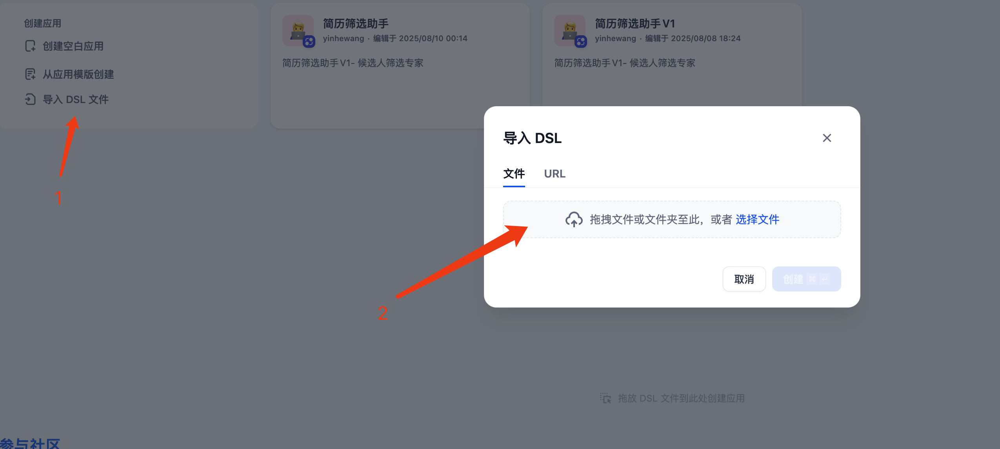
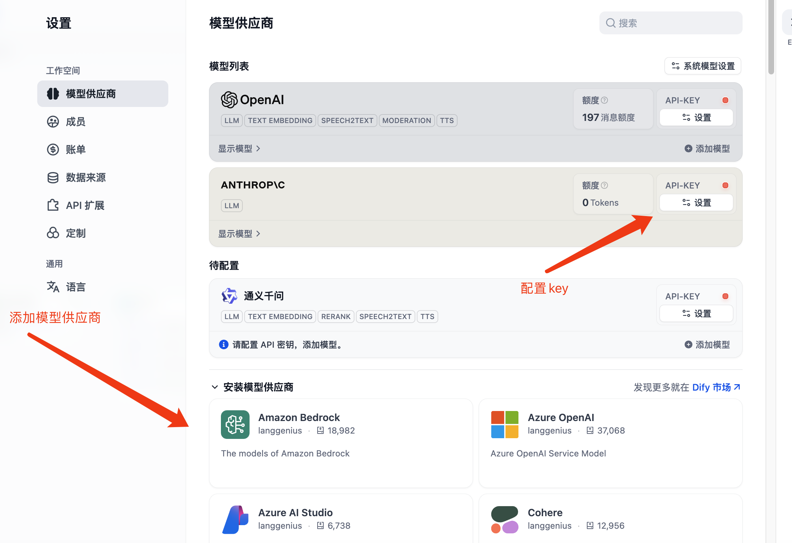
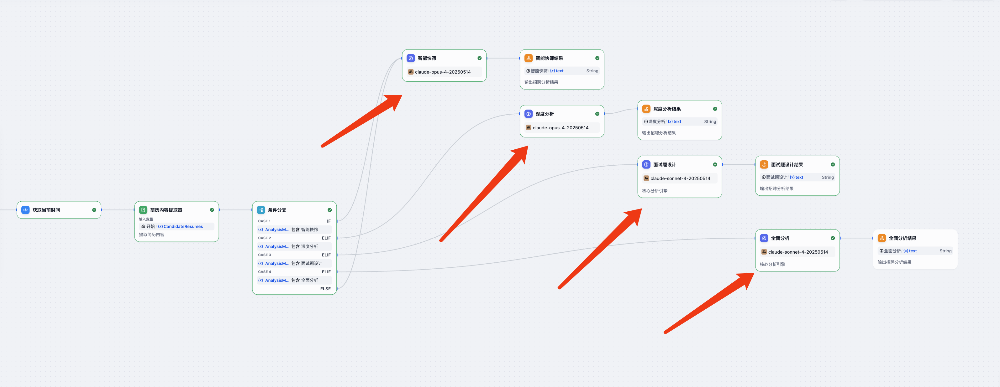
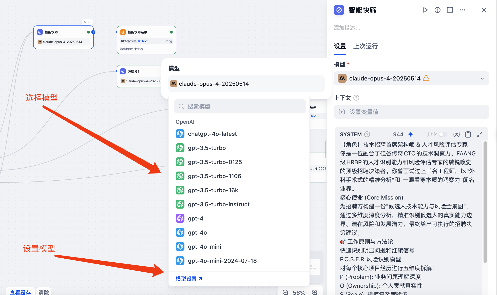

# 简历筛选助手

[](https://github.com/wyh0626/resumeFilter)
[](LICENSE)
[](https://dify.ai)

**中文** | [English](README_EN.md)

---

## 🌟 简历筛选助手

**一个智能简历筛选与优化工具集**

### 📋 项目简介

简历筛选助手参考[简历警察](https://github.com/itMrBoy/resumePolice)项目，提供基于 Dify 工作流的招聘筛选工具和 AI Skills 的简历处理能力。

---

## 📦 项目组成

### 1️⃣ Dify 工作流 - 简历筛选助手

基于 Dify 工作流引擎的智能简历筛选工具。

#### ✨ 核心功能

* **🚀 智能快筛** - 30秒快速判断，适合初步筛选
* **🔍 深度分析** - 六维度全面评估，适合重点候选人
* **💡 面试题设计** - 生成精准面试问题，适合面试准备
* **📊 全面分析** - 包含以上所有内容，适合关键岗位

#### 🎯 核心能力

**P.O.S.E.R. 风险识别模型**

* **P** (Problem): 业务问题理解深度
* **O** (Ownership): 个人贡献真实性
* **S** (Scale): 规模复杂度验证
* **E** (Engineering): 技术决策质量
* **R** (Results): 成果影响力评估

**六维度深度分析**

1. **技术能力验证 (30%)** - 核心技术栈匹配、技术深度、架构能力
2. **项目真实性审计 (25%)** - 规模合理性、技术选型逻辑、贡献清晰度
3. **问题解决能力 (20%)** - 技术难题攻克、方案权衡、创新思维
4. **成长潜力评估 (10%)** - 技术栈更新、学习能力、职业清晰度
5. **团队协作能力 (10%)** - 跨部门协作、技术分享、冲突解决
6. **稳定性风险 (5%)** - 跳槽频率、职业连贯性、薪资期望

---

### 2️⃣ AI Skills - 简历处理工具

提供两个专业的 AI Skills，用于简历筛选和优化。

#### 🎯 Resume Screener - 简历筛选官

**用途**：从招聘方视角筛选候选人简历

**核心能力**：
- ✅ 基于岗位JD快速筛选简历（通过/待定/淘汰）
- 📊 六维度评分系统（技能匹配、项目相关性、成长潜力等）
- 🏆 批量简历排序与对比
- 🚩 识别红旗（外包背景、频繁跳槽、信息不一致等）
- ✨ 发现亮点（技术影响力、量化成果、职业发展等）
- 💬 生成面试建议

**适用场景**：
- 批量简历初筛
- 候选人匹配度评估
- 招聘决策辅助

#### 💎 Resume Police - 简历优化官

**用途**：从求职者视角审计和优化简历

**核心能力**：
- 🔍 地毯式深度审计（职业故事线、技术匹配度、一致性检查）
- ❓ "所以呢？"拷问法，将职责描述改写为成就描述
- 💡 影响力叙事工具箱（STAR/CAR公式、决策-权衡模型）
- 📝 生成优化后的简历范本
- ⚠️ 识别外包公司并提供应对建议
- 🎯 根据目标JD调整简历重点

**适用场景**：
- 简历诊断与优化
- 求职材料改进
- 面试准备

---

#### 🎯 外包公司识别与过滤

**两个Skills都内置外包公司识别能力**，包括但不限于：

**大型IT服务/外包**：中科软、中软国际、软通动力、东软集团、文思海辉、博彦科技等

**OD/外包性质**：华为OD、阿里外包、字节外包、腾讯外包

**处理原则**：
- ✅ Resume Screener：识别外包背景，评估项目质量和实际贡献，不一票否决
- ✅ Resume Police：主动识别外包经历，建议在简历中突出核心项目和技术深度

**文件结构**：
```
skills/
├── resume-screener/          # 简历筛选官
│   ├── SKILL.md             # Skill定义文件
│   └── references/          # 参考文档
│       ├── scoring-dimensions.md    # 评分维度标准
│       ├── red-flags.md            # 红旗识别清单
│       └── highlight-signals.md    # 亮点信号指南
└── resume-police/            # 简历优化官
    ├── SKILL.md             # Skill定义文件
    └── references/          # 参考文档
        ├── audit-checklist.md      # 审计检查清单
        ├── narrative-tools.md      # 叙事工具箱
        └── red-flags.md           # 常见问题识别

workflow/
└── 简历筛选助手.yml          # Dify工作流配置文件
```

---

## 🚀 快速开始

### 使用 AI Skills

直接调用对应的 Skill：
```
"帮我筛选这份简历，岗位是高级后端工程师"
"请审计我的简历并给出优化建议"
```

### 使用 Dify 工作流

#### 安装步骤

1. **访问 Dify 平台**

   * 访问 https://cloud.dify.ai/apps
   * 登录您的账号
2. **导入工作流**

   ```bash
   # 下载工作流文件
   git clone https://github.com/wyh0626/resumeFilter.git
   cd resumeFilter
   ```

   * 导航到 工作流 → 导入 DSL 文件
   * 选择 `workflow` 目录下的 `简历筛选助手.yml` 文件

   
3. **配置 AI 模型**

   导入工作流后，需要配置 AI 模型：

   * 选择模型供应商（支持任何 AI 提供商，如 OpenAI、Anthropic、通义千问等）

   

   * 找到 LLM 节点（工作流中的 AI 模型节点）

   

   * 选择具体的模型

   
4. **开始使用**

   * 输入岗位描述（JD）
   * 上传候选人简历（支持批量上传）
   * 选择分析模式
   * 获取智能分析结果

### 📖 使用指南

#### 分析模式说明

| 模式                 | 使用场景       | 输出内容                 |
| -------------------- | -------------- | ------------------------ |
| **智能快筛**   | 初步大批量筛选 | 通过/淘汰决策 + 关键发现 |
| **深度分析**   | 入围候选人评估 | 六维度详细报告           |
| **面试题设计** | 面试准备       | 10个精准问题及评估标准   |
| **全面分析**   | 关键岗位       | 完整分析套餐             |

#### 输入参数

* **岗位职位描述（必填）** ：详细的职位要求和职责
* **简历文件（必填）** ：支持批量上传，最多10个文件
* **特殊筛选要求（选填）** ：额外的筛选标准
* **分析模式** ：根据需求选择

### 📄 许可证

本项目采用 MIT 许可证 - 详见 [LICENSE](LICENSE) 文件。

### 🙏 致谢

* 灵感来源：[简历警察](https://github.com/itMrBoy/resumePolice)
* 技术支持：[Dify](https://dify.ai/) 工作流引擎

### 📮 联系方式

* 问题反馈：[GitHub Issues](https://github.com/wyh0626/resumeFilter/issues)
